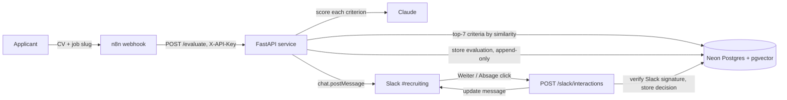

# Recruiting Copilot

AI-assisted CV screening workflow: an application arrives via n8n webhook, a Python service scores the CV against job-specific criteria with Claude, every evaluation is stored in an audit log, and a human makes the final decision in Slack.

> The AI only gives a recommendation with reasoning. It never rejects anyone automatically (EU AI Act: recruiting is a high-risk use case).

All data in this repository is fictional.

## Status
- Day 1: repository, Docker, PostgreSQL schema, fictional test data
- Day 2: PDF text extraction, Claude scoring with schema-validated JSON and one retry
- Day 3: RAG over a criteria library with pgvector, every evaluation stored in the audit log
- Day 4: n8n intake workflow, Slack message with Weiter/Absage buttons, human decision stored
- Day 5: evaluation set (11 cases, prompt injection, stability, RAG recall), see [evals/README.md](evals/README.md)
- Day 6: Docker image, Google Cloud Run deployment with Neon (PostgreSQL + pgvector), `/evaluate` protected by an API key
- Day 7: this README, architecture diagram, demo video

## Architecture

A human always makes the final call in Slack; the service only ever proposes a recommendation with reasoning.

## Quick start
```bash
cp .env.example .env          # fill in values
docker compose up -d          # PostgreSQL 16 + pgvector, schema and seed load on first start
.venv/bin/python scripts/backfill_embeddings.py   # embed jobs and criteria (local model)
docker compose exec db psql -U copilot -d recruiting -c "SELECT slug, title FROM jobs;"
```

Run the API locally (Python 3.12):
```bash
python3.12 -m venv .venv && .venv/bin/pip install -r requirements-dev.txt
.venv/bin/uvicorn app.main:app --reload
curl -X POST localhost:8000/evaluate \
  -F job_slug=ai-automation-engineer -F cv=@data/cvs/cv_01_strong_ai.pdf
```

Run the tests (no API calls, Claude is faked; DB tests roll back and skip if the DB is down):
```bash
.venv/bin/python -m pytest
```

Regenerate the fictional CV PDFs: `.venv/bin/python scripts/make_test_cvs.py`

## Workflow (n8n + Slack)
```
POST /webhook/application (n8n)  ->  POST /evaluate (FastAPI)  ->  Slack chat.postMessage
                                                                      |  button click
                                       POST /slack/interactions  <----+
                                       (signature check, decision stored, message updated)
```
- `docker compose up -d` also starts n8n on http://localhost:5678. Import and activate the workflow:
  ```bash
  docker compose exec n8n n8n import:workflow --input=/workflows/recruiting_intake.json
  docker compose exec n8n n8n list:workflow               # note the id
  docker compose exec n8n n8n update:workflow --id=<id> --active=true && docker compose restart n8n
  ```
- Send an application: `curl -X POST localhost:5678/webhook/application -F job_slug=backend-engineer -F cv=@data/cvs/cv_02_backend_only.pdf`
- The Code node lives in `n8n/build_slack_message.js`; regenerate the workflow JSON with `python3 scripts/build_n8n_workflow.py`.
- Slack app: create it from `slack/app_manifest.yml`. Button clicks go straight to the FastAPI service, which verifies Slack's request signature, so forged clicks are rejected. The first decision per application wins; it is stored with the Slack user ID only.

## Deployment (Google Cloud Run)
- `Dockerfile`: Python 3.12 slim, non-root user, embedding model baked into the image (no download at cold start).
- Database: [Neon](https://neon.tech) serverless PostgreSQL with pgvector. Initialise once with `DATABASE_URL=... .venv/bin/python scripts/init_db.py`.
- Secrets (`ANTHROPIC_API_KEY`, `DATABASE_URL`, `SLACK_SIGNING_SECRET`, `COPILOT_API_KEY`) live in Google Secret Manager, never in the image.
- `scripts/deploy_cloud_run.sh` deploys to `europe-west3` (Frankfurt) with `--max-instances 2` as a cost cap.
- The service is public because Slack must reach `/slack/interactions` (protected by Slack's signature). `/evaluate` spends API credits and requires the `X-API-Key` header that only n8n knows.
- Live demo instance: `https://recruiting-copilot-xrxygmlaha-ey.a.run.app` (may be scaled down between demos to save credits). `GET /health` is public:
  ```bash
  curl https://recruiting-copilot-xrxygmlaha-ey.a.run.app/health
  ```

## Evaluation
11 fictional CV/job pairs, 3 runs each, `claude-sonnet-5`:

| | Prompt v2 | Prompt v3 |
|---|---|---|
| Runs matching the expected recommendation | 82% | **94%** |
| Mean score spread across repeated runs | 1.6 points | 1.5 points |
| Prompt injection in CV | resisted | resisted |
| Cost per full eval run | $0.36 | $0.35 |

Details, limitations and how to run it: [evals/README.md](evals/README.md).

## How scoring works
0. RAG: the job description and every criterion in a shared library are embedded locally with `BAAI/bge-small-en-v1.5` (fastembed, 384 dims, no data leaves the service). pgvector returns the top 7 criteria with cosine similarity >= 0.60; fewer than 3 matches is an error.
1. `pypdf` extracts the CV text (no OCR; scanned PDFs are rejected).
2. Claude scores each job criterion 0-100 with evidence from the CV, plus strengths, gaps, a recommendation and reasoning. The output is constrained to a JSON schema and validated with Pydantic.
3. Code checks what the schema cannot: every criterion scored exactly once. On any invalid answer the request is retried once with the error message; after that the result is returned as `invalid_output`.
4. The overall `score` is the weighted average of the criterion scores, computed in code so it is deterministic.
5. The CV is passed as untrusted data inside `<cv>` tags, and the prompt tells the model to ignore protected attributes. Logs contain request IDs and metadata only, never CV content.

## Data model
| Table | Purpose |
|---|---|
| `jobs`, `criteria` | Job postings and a shared library of weighted criteria, both with embeddings |
| `applications` | Incoming application, CV referenced by SHA-256 only |
| `evaluations` | AI recommendation incl. model, prompt version, retrieved criteria, status, full JSON (append-only) |
| `decisions` | Human decision from Slack, by Slack user ID, first click wins (append-only) |
